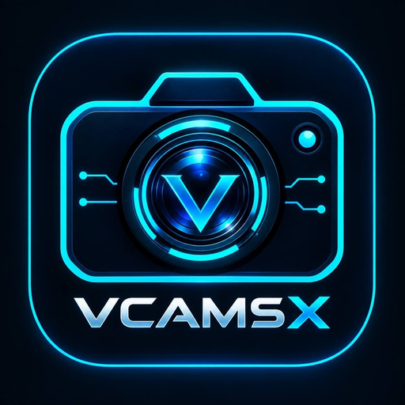

# VCAMSX

Official Android downloads, setup guides and support.

**[Download VCAMSX 2.1.3](https://github.com/Hushcedar/Vcamsx/releases/latest/download/VCAMSX.apk)** · **[Setup guide](docs/SETUP.md)** · **[Get support](https://github.com/Hushcedar/Vcamsx/issues/new/choose)**

Android 10 or newer

## Download

Download **[VCAMSX.apk](https://github.com/Hushcedar/Vcamsx/releases/latest/download/VCAMSX.apk)** and open it on your Android phone. To update, install it over your existing official VCAMSX app.

[Download page](https://hushcedar.github.io/Vcamsx/downloads.html) · [Release notes](https://github.com/Hushcedar/Vcamsx/releases/latest) · [Previous releases](https://github.com/Hushcedar/Vcamsx/releases)

## What VCAMSX does

VCAMSX lets you choose video, images and live streams for supported target apps, with floating controls for playback and audio.

- Video and image selection.
- HLS, HTTP, RTMP and RTSP streaming.
- Floating playback controls.
- Audio selection and local monitoring.
- Root and supported no-root setup options.

Compatibility depends on your phone, selected engine and target app version.

## Install

1. Download the APK using the link above.
2. Open it on your phone and approve installation if Android prompts.
3. Open VCAMSX and follow your chosen engine's in-app setup tutorial.
4. Select your target app and media, then enable the controls you need.

[Read the setup guide](docs/SETUP.md)

## Activation

Purchase or restore access inside **My Keys / Buy Keys** in the app.

**30 days:** $15.00 USD through NOWPayments, or ₦21,000 NGN through Flutterwave.

Already paid? Return to VCAMSX and tap **I paid · Check**.

## Support

Use **[GitHub Issues](https://github.com/Hushcedar/Vcamsx/issues/new/choose)** for setup help, bug reports and download problems. Include your phone model, Android version and selected engine. Keep license keys and payment details private.

## Repository

This repository contains official downloads, documentation and support. The Android application's source code is not published here.
